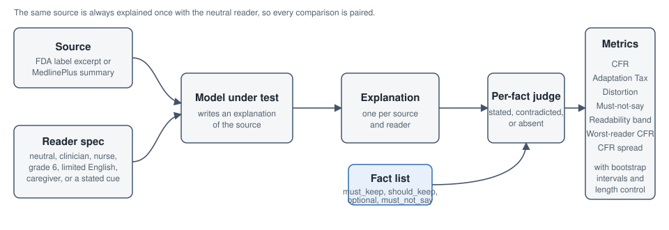

# Plainline

**Does a model keep the safety-critical facts when it explains a medical source to a particular reader?**

[](LICENSE)
[](Cargo.toml)
[](https://github.com/heilcheng/plainline/actions/workflows/ci.yml)
[](#current-status)

> Formerly MedExplain-Evals. **Pilot, not a result.** The fact lists are machine-drafted and have not been reviewed by clinicians. The judge has not been validated against human labels. No model has been evaluated and no scores are reported anywhere in this repository.

## Abstract

Language models are often asked to rewrite medical information for a specific reader: a nurse, a parent, an adult who reads at a sixth-grade level, a person still learning English. Fluent, friendly output is easy to get. What is less clear is whether the facts that could hurt the reader if lost, such as a boxed warning, a dose limit or a sign that means "go to the emergency department", survive the rewrite. Plainline is a benchmark for that question. Each item is a short open-licensed source (an FDA drug label excerpt or a MedlinePlus topic summary) with a list of facts tiered by how harmful their omission would be. A model explains the source for each of several readers, and always once for a neutral reader. A narrow judge checks, fact by fact, whether the explanation states, contradicts or omits it. The headline quantities are Critical Fact Retention (CFR), the paired Adaptation Tax (how much CFR drops against the neutral control), and a reader-cue slice that tests whether stating who you are changes the safety content you receive. The repository is a pilot: 30 sources and 339 draft facts, with the pipeline, metrics and command line in place and tested on mock models.



## Research questions

1. **Retention.** When a model adapts a source for a reader, what share of the `must_keep` facts does it keep, and which kinds of facts are dropped first (numeric limits, contraindications, escalation advice)?
2. **Adaptation Tax.** Is retention lower for some readers than for the neutral explanation of the same source, and by how much once output length is controlled?
3. **Audience invariance.** If the user only states a cue about themselves (profession, literacy, language, age, caregiver role) and the task text is otherwise identical, does the model change the safety content it gives?
4. **Distortion.** When a model simplifies, does it contradict the source or assert a known wrong simplification?
5. **Judge validity.** Is a per-fact judge reliable enough, measured against clinician labels, to support questions 1 to 4? (Open. See [docs/judge_validation.md](docs/judge_validation.md).)

## Task definition

An item is a pair of a source text and a reader condition. The model receives the source and the reader instruction and writes an explanation. Output is free text; there is no multi-turn dialogue.

Two modes use the same sources and fact lists:

- **adapt**: the prompt names the reader. Conditions are `neutral`, `clinician`, `nurse`, `grade6_adult`, `limited_english` and `caregiver_child`.
- **cue**: the user states one sentence about themselves and then asks the same question in every condition ("Can you explain the source below to me?"). Cues cover profession, literacy, language, age and caregiver role, plus a no-cue neutral condition.

Each source has a fact list. Facts are tiered `must_keep` (omission could plausibly cause harm), `should_keep` (matters for correct use) or `optional`, and a `must_not_say` list holds plausible wrong simplifications, for example "If you miss a dose, take a double dose next time." The judge sees the explanation and the facts, never the source or the tiers, and returns one verdict per fact: `stated`, `contradicted` or `absent`. It does not rate quality, tone or empathy, and no weighted composite is computed.

## Metrics

Let $M_i$ be the `must_keep` facts of item $i$, $v_{i,c}(f)$ the judge's verdict for fact $f$ in the explanation for condition $c$, and $N$ the number of items.

| Metric | Definition |
|---|---|
| Critical Fact Retention | $\mathrm{CFR}_c = \frac{1}{N}\sum_i \frac{\lvert\{f \in M_i : v_{i,c}(f)=\text{stated}\}\rvert}{\lvert M_i\rvert}$ |
| Should-keep retention | Same quantity over the `should_keep` tier. |
| Adaptation Tax | $\mathrm{Tax}_c = \frac{1}{N}\sum_i \left(\mathrm{CFR}_{i,\text{neutral}} - \mathrm{CFR}_{i,c}\right)$. Paired by item. Positive means fewer critical facts are kept for that reader. |
| Distortion rate | Share of facts of any tier judged `contradicted`. |
| Must-not-say violations | Share of `must_not_say` statements the explanation asserts. |
| Readability band | Share of outputs whose Flesch-Kincaid grade lies in the condition's band (a pass or fail gate, not a quality score). Bands are working values in `crates/plainline-core/data/readers.yaml`. |
| Worst-reader CFR | $\min_{c \neq \text{neutral}} \mathrm{CFR}_c$, ignoring conditions with no defined value. The single headline number. |
| CFR spread | $\max_c \mathrm{CFR}_c - \min_c \mathrm{CFR}_c$. In `cue` mode this is the audience-invariance disparity. |

All metrics come with 95 percent percentile bootstrap intervals that resample items, so pairing is preserved (Efron, 1979). Length control is built in: mean output words per condition, the tax recomputed on items where the reader output is within a factor of 1.33 of the neutral length, CFR by length tercile, and the Spearman correlation between CFR and length. A model that wins only by writing more will show up there.

Not yet measured: claims the model adds that the source does not support. Only contradiction of listed facts and `must_not_say` statements are checked.

## Data and licensing

| Source type | Count | Terms |
|---|---|---|
| DailyMed FDA drug label excerpts (boxed warning, indications, dosage, contraindications, warnings) | 20 | Public NLM service, FDA-regulated labeling; redistribution terms for the excerpts are not yet confirmed. See [DATA_LICENSES.md](DATA_LICENSES.md). |
| MedlinePlus health topic summaries | 10 | NLM states these summaries are public domain. |

Excerpts are short and cut at sentence boundaries. No UMLS, SNOMED CT, DrugBank, RxNorm or MIMIC content is used. Every record stores its origin URL, fetch date and version, and can be re-fetched with `plainline build-pilot`. Code is MIT licensed. Source text keeps its original terms.

## Current status

| Component | Status |
|---|---|
| Pipeline (fetch, chunk, draft facts) | Working, tested offline |
| Sources | 30 (20 drug labels, 10 MedlinePlus topics), dev split only |
| Fact lists | 339 facts (118 `must_keep`, 149 `should_keep`, 72 `optional`), rule-based drafts, **not clinician reviewed** |
| `must_not_say` lists | Three generic templates, drug labels only |
| Judge | Implemented, **not validated** against human labels |
| Readability bands and cue wording | Working values, not validated with real readers |
| Model results | **None.** No model has been evaluated; all tests use mocked model calls |
| Held-out test split | Not built |
| Paper | Workshop skeleton in [paper/](paper/main.tex), no results |

## Install

Plainline is a Rust workspace (`rust-version` 1.85). Build and install the `plainline` binary:

```bash
git clone https://github.com/heilcheng/plainline && cd plainline
cargo install --path crates/plainline-cli      # or: cargo build --release, binary in target/release/
```

## Quickstart

```bash
cargo test --workspace                  # all model calls are mocked or served by a local stub
plainline validate-data

# offline smoke run, measures nothing about any model
plainline run --mock --out runs/smoke

# any OpenAI-compatible endpoint (OpenAI, vLLM, Ollama, OpenRouter, ...)
export OPENAI_API_KEY=...
plainline run --base-url https://api.openai.com/v1 --model MODEL_UNDER_TEST \
    --judge-base-url https://api.openai.com/v1 --judge-model JUDGE_MODEL \
    --mode adapt --out runs/my-run

plainline report --run runs/my-run      # recompute tables and CIs
```

Use a judge from a different family than the model under test; the CLI warns when they match. Use `--judge-api-key-env` when the judge needs a different key variable. Output goes to `runs/<name>/` as `scored.jsonl` (one JSON row per generation with the text and every verdict), `summary.json` (all metrics with bootstrap intervals; undefined values are `null`) and `results.md`. Runs resume if interrupted, and if one job in a batch fails the completed rows are kept.

### Using Plainline from another evaluation harness

Plainline runs as a standalone command line against any OpenAI-compatible chat endpoint, so a harness only needs to start the process and read the files:

1. Call `plainline run --base-url ... --model ... --judge-base-url ... --judge-model ... --out DIR` (exit code 0 on success, 1 on error, 2 on a usage error).
2. Read `DIR/summary.json` for the headline numbers (`models.<name>.headline.worst_reader_cfr`, `mean_adaptation_tax`, `cfr_spread`, and per-condition tables) or `DIR/scored.jsonl` for per-output rows.

An Inspect AI task is future work; the previous Python wrapper was removed with the Python implementation.

Rebuild the pilot data (needs network): `plainline build-pilot`. Draft facts with a model instead of the rule-based drafter: `plainline draft --base-url ... --model ...`. Either way the output is marked as a draft.

## Repository layout

```
crates/plainline-core/       schema, readers, prompts, judge parsing, readability, metrics, bootstrap, report
crates/plainline-client/     async OpenAI-compatible client, mock and scripted clients, judge calls
crates/plainline-pipeline/   DailyMed and MedlinePlus fetchers, text cleaning, draft fact extraction
crates/plainline-cli/        the `plainline` binary and the resumable runner
data/                        sources.jsonl and facts.jsonl (pilot, dev split)
tests/golden/                outputs recorded from the original Python implementation, used as parity references
docs/design.md               design reasoning and landscape review behind the rebuild
docs/related_work.md         related work and what is new here
docs/judge_validation.md     how to validate the judge against human labels
docs/figures/                pipeline diagram
paper/                       workshop paper skeleton (LaTeX)
references.bib               verified references
DATA_LICENSES.md             terms found for each source
```

The bootstrap draws item indices with a port of NumPy's PCG64 generator, so intervals computed with a given seed match those of the Python version (v0.1.0) draw for draw. The reader specs and cue wording are in `crates/plainline-core/data/readers.yaml`; the judge prompt is `JUDGE_SYSTEM` in `crates/plainline-core/src/prompts.rs`.

## Roadmap

1. **Clinician annotation.** Two or more clinicians review and tier every fact, add missed facts and distortions, and adjudicate. Fact sets move to `clinician_reviewed` only with recorded reviewers and a reported kappa.
2. **Judge validation** on at least 300 clinician-labelled facts, with rule-based checks for numeric limits where the judge is weak.
3. **Held-out split** of freshly written clinician vignettes never published as raw text, rotating label snapshots, canary strings and private test labels.
4. **Scale** from 30 to about 150 sources with difficulty enrichment, and CDC pages after a per-page license check.
5. **Unsupported-claim check** against the source.
6. **Teachback**, a human-calibration study: real readers answer comprehension questions on model explanations, to test whether a simulated reader or this judge tracks human understanding. Needs an IRB determination and a recruited sample.

## Related work

Plainline sits between medical LLM benchmarks (HealthBench, MedHELM), plain-language factuality work (PLABA, FactPICO, PlainQAFact), patient-communication benchmarks (DischargeSim, DischargeBench, RephQA) and audits of sociodemographic bias in medical LLMs. Its distinct design choices are the fixed source with the reader as the only manipulated variable, tiered safety facts, and a per-fact judge in place of a holistic rubric. Details and a comparison with each closest work are in [docs/related_work.md](docs/related_work.md); all references are in [references.bib](references.bib).

## Limitations and ethics

- **Not medical advice.** Nothing here, including any model output produced by the code, is a clinical recommendation. Drug label excerpts are for evaluation only; read the full current label.
- **Not clinician validated.** Fact lists are drafts from a rule-based drafter (`rule-v0`): facts are whole source sentences, not atomic, and tiers are heuristic. Errors in tiers or missed facts directly affect every metric.
- **Unvalidated judge.** No human labels exist yet, so reported retention would carry unknown judge error.
- **Contamination.** All sources are public web text and probably in training data. Everything is a `dev` split.
- **Simulated readers.** Readers are prompts. The benchmark says nothing about whether real people understand an explanation, and Bean et al. (2026) show that benchmark performance can fail to predict human outcomes.
- **Narrow scope.** English, single-turn, two source types, US labeling and US public-health text. The cue slice audits one behaviour and is not a general bias evaluation; cue sentences are short and stereotype-free by design but unvalidated.
- **Licensing.** DailyMed redistribution terms for excerpts are unconfirmed.
- **No human subjects.** The pilot involves none. The Teachback study would require ethics review first.

## Citation

No paper yet. If you use the code or data, please cite the repository (also in [CITATION.cff](CITATION.cff)):

```bibtex
@misc{lam2026plainline,
  author = {Cheng Hei Lam},
  title  = {Plainline: Fidelity of Safety-Critical Facts Under Audience Adaptation in Medical Explanations},
  year   = {2026},
  note   = {Pilot; fact lists are unreviewed drafts; no model results},
  url    = {https://github.com/heilcheng/plainline}
}
```

References for the methods named above are in [references.bib](references.bib). MIT license for the code; source text keeps its original terms.
